<!-- Everything in assets/ comes from scripts/build.mjs: npm install && npm run build -->

<a href="https://securebusinesshub.com">
  
</a>

  <a href="https://securebusinesshub.com"></a>
  
  <a href="https://securebusinesshub.com/toolkit/starter-kit"></a>
  
  


## What I'm building

<a href="https://securebusinesshub.com/tools">
  
</a>

[SecureBusinessHub](https://securebusinesshub.com) is a cybersecurity publication for small and medium businesses. I write the articles, and I build, run and deploy the site myself. Most security writing is aimed at enterprise SOC teams or is quietly selling a product. SBH is for the ten-person company where security landed on whoever was nearest: guides you can get through in an afternoon, and free tools that each answer one question.

| Tool | What it tells you |
| :--- | :--- |
| [Email Spoofing Check](https://securebusinesshub.com/tools/email-spoofing-check) | Whether your SPF, DKIM and DMARC records stop someone sending mail as you |
| [Lookalike-Domain Finder](https://securebusinesshub.com/tools/lookalike-domain-finder) | Near-copies of your domain that someone has already registered |
| [Website Exposure Check](https://securebusinesshub.com/tools/website-exposure-check) | Your security headers, TLS certificate and cookie flags, as an outsider sees them |
| [Security Baseline Check](https://securebusinesshub.com/tools/security-baseline-check) | A pass or fail against a [published baseline](https://securebusinesshub.com/tools/security-baseline-check/methodology). Sites that pass get a badge, and it's re-checked every week |
| [Email Header Analyzer](https://securebusinesshub.com/tools/email-header-analyzer) | Where a suspicious email really came from. You paste the headers and the analysis runs in your browser |
| [Breach-Notification Clock](https://securebusinesshub.com/tools/breach-notification-deadline-calculator) | The minute your GDPR 72-hour window to notify the regulator closes |

## How it's built


The front end is Vite, React and TypeScript with Tailwind, set in Fraunces and Inter. A Cloudflare Worker renders each page through `HTMLRewriter`, so search engines get real HTML instead of an empty shell. Articles live in D1 and downloads in R2. Stripe Checkout handles Starter Kit payments, and buyers get their files through a download token. Search is Pagefind, which runs in the browser, and the site chatbot runs on Workers AI.

Outside SBH I'm finishing a higher vocational degree in Systems Administration and Networks (ASIR) on the cybersecurity track. That means Cisco switching and routing, VLANs, Linux and Windows Server, and databases. Once it's done I want to move into offensive security.

## Where to start reading

  <a href="https://securebusinesshub.com/article/sme-ransomware-survival-guide"></a>
  <a href="https://securebusinesshub.com/article/cyber-insurance-denied-sme"></a>
  <a href="https://securebusinesshub.com/article/deepfake-fraud-sme-defense"></a>
  <a href="https://securebusinesshub.com/article/gdpr-compliance-guide"></a>
  <a href="https://securebusinesshub.com/article/anti-social-engineering"></a>
  <a href="https://securebusinesshub.com/article/shadow-it-remote-work-risks"></a>

There's more on the site: [every guide](https://securebusinesshub.com/guides), the free [Defense Toolkit](https://securebusinesshub.com/toolkit), and a [security assessment](https://securebusinesshub.com/assessment).

 

  Catalonia, ES · I work in Català, Español and English · <a href="https://securebusinesshub.com/contact">get in touch</a>

