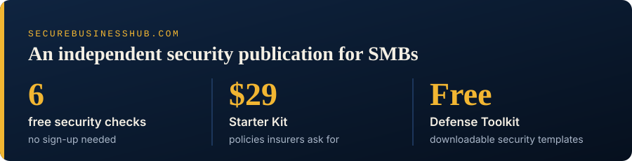

<a href="https://securebusinesshub.com">
  <picture>
    <source media="(prefers-color-scheme: dark)" srcset="./assets/banner-dark.svg">
    <source media="(prefers-color-scheme: light)" srcset="./assets/banner-light.svg">
    
  </picture>
</a>

  
  
  
  

 

  

## ◆ What I'm building

**[SecureBusinessHub](https://securebusinesshub.com)** is an independent cybersecurity publication for small and medium businesses. I run it solo: the writing, the design, the code and the deploys. The idea is simple. Most security content is either written for enterprise SOC teams or written to sell you something. SBH is neither: evergreen guides an owner can read on a Tuesday and act on by Friday, plus free tools that answer one question each.

| Tool | What it tells you |
| :--- | :--- |
| [Email Spoofing Check](https://securebusinesshub.com/tools/email-spoofing-check) | Whether your SPF, DKIM and DMARC actually stop someone sending as you |
| [Lookalike-Domain Finder](https://securebusinesshub.com/tools/lookalike-domain-finder) | Which near-copies of your domain are already registered |
| [Website Exposure Check](https://securebusinesshub.com/tools/website-exposure-check) | Security headers, certificate and cookie flags at a glance |
| [Security Baseline Check](https://securebusinesshub.com/tools/security-baseline-check) | Your email and web setup against a [published baseline](https://securebusinesshub.com/tools/security-baseline-check/methodology), with a badge that gets re-checked weekly |
| [Email Header Analyzer](https://securebusinesshub.com/tools/email-header-analyzer) | Paste the headers of a suspicious email, get a verdict. Runs in your browser |
| [Breach-Notification Clock](https://securebusinesshub.com/tools/breach-notification-deadline-calculator) | When your GDPR 72-hour window actually closes |

## ◆ Under the hood

  

- **Frontend:** Vite + React + TypeScript, editorial design system (Fraunces / Inter / JetBrains Mono)
- **Edge:** Cloudflare Workers with server-side rendering through `HTMLRewriter`, so crawlers get real HTML
- **Data:** D1 for content, R2 for downloads, Stripe Checkout with token-gated delivery for the kit
- **Search:** Pagefind, client-side, no third-party search box

  

Outside SBH I'm finishing a higher vocational degree in **Systems Administration & Networks (ASIR)** with a cybersecurity focus: Cisco, VLANs and routing, Linux and Windows Server, databases. The plan from here is offensive security.

## ◆ Worth reading on SBH

- [SME Ransomware Survival Guide](https://securebusinesshub.com/article/sme-ransomware-survival-guide)
- [Why Cyber Insurance Claims Get Denied](https://securebusinesshub.com/article/cyber-insurance-denied-sme)
- [Defending Against Deepfake Fraud](https://securebusinesshub.com/article/deepfake-fraud-sme-defense)
- [GDPR Compliance Guide](https://securebusinesshub.com/article/gdpr-compliance-guide)
- [Anti-Social Engineering](https://securebusinesshub.com/article/anti-social-engineering)

→ [All guides](https://securebusinesshub.com/guides) · [Free Defense Toolkit](https://securebusinesshub.com/toolkit) · [Run the free security assessment](https://securebusinesshub.com/assessment)

 

  Catalonia, ES · I work in Català, Español and English · <a href="https://securebusinesshub.com/contact">get in touch</a>

