<a href="https://securebusinesshub.com">
  <picture>
    <source media="(prefers-color-scheme: dark)" srcset="./assets/banner-dark.svg">
    <source media="(prefers-color-scheme: light)" srcset="./assets/banner-light.svg">
    
  </picture>
</a>

  
  
  
  

 

  

## ◆ What I'm building

[SecureBusinessHub](https://securebusinesshub.com) is an independent cybersecurity publication for small and medium businesses. I write the articles, build the site and deploy it myself. Most security writing out there targets enterprise SOC teams or is trying to sell you a product. SBH is aimed at the ten-person company with no security team: guides an owner can get through in an afternoon, and free tools that each answer one specific question.

| Tool | What it tells you |
| :--- | :--- |
| [Email Spoofing Check](https://securebusinesshub.com/tools/email-spoofing-check) | Whether your SPF, DKIM and DMARC stop someone from sending email as you |
| [Lookalike-Domain Finder](https://securebusinesshub.com/tools/lookalike-domain-finder) | Which near-copies of your domain are already registered |
| [Website Exposure Check](https://securebusinesshub.com/tools/website-exposure-check) | How your site's security headers, certificate and cookie flags look from outside |
| [Security Baseline Check](https://securebusinesshub.com/tools/security-baseline-check) | How your email and web setup compare to a [published baseline](https://securebusinesshub.com/tools/security-baseline-check/methodology). A pass earns a badge that gets re-checked every week |
| [Email Header Analyzer](https://securebusinesshub.com/tools/email-header-analyzer) | Whether a suspicious email is what it claims to be. You paste the headers and the analysis runs in your browser |
| [Breach-Notification Clock](https://securebusinesshub.com/tools/breach-notification-deadline-calculator) | The exact moment your GDPR 72-hour notification window closes |

## ◆ Under the hood

  

The front end is Vite, React and TypeScript with Tailwind, set in Fraunces, Inter and JetBrains Mono. Pages are rendered on Cloudflare Workers through `HTMLRewriter`, so search engines get real HTML instead of an empty shell. Content lives in D1 and downloads in R2. The Starter Kit sells through Stripe Checkout, and buyers get their files through a download token. Site search is Pagefind, running client-side.

  

Outside SBH I'm finishing a higher vocational degree in Systems Administration and Networks (ASIR) with a cybersecurity focus, which covers Cisco, VLANs and routing, Linux and Windows Server, and databases. After that I want to move into offensive security.

## ◆ Worth reading on SBH

  
  
  
  
  
  

→ [All guides](https://securebusinesshub.com/guides) · [Free Defense Toolkit](https://securebusinesshub.com/toolkit) · [Run the free security assessment](https://securebusinesshub.com/assessment)

 

  Catalonia, ES · I work in Català, Español and English · <a href="https://securebusinesshub.com/contact">get in touch</a>

